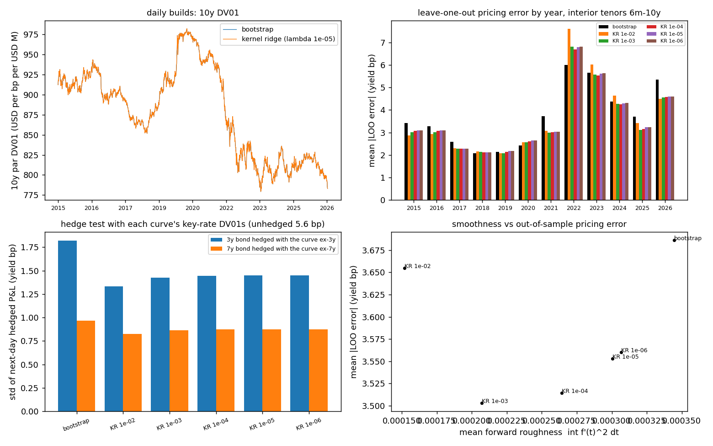
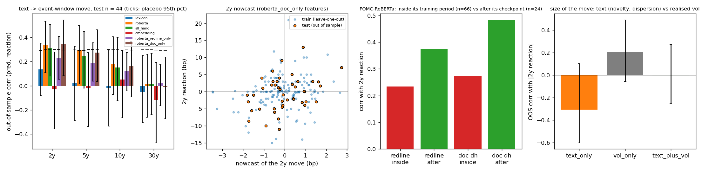

# rates-curve-nlp

Machine-learned Treasury curves for pricing, hedging and quoting, in header-only C++ with a numpy port of the curve engine as an independent check. Tested out of sample on 2015–2026 Treasury yields and on FOMC and ECB statements.

The question: does machine learning beat the classical answers (a Hagan–West bootstrap for the curve, key-rate DV01s for the hedge, a word list for the text), and does any of it pay in an RFQ simulator with informed flow and scheduled events?

## Results

- **Curve.** A kernel-ridge discount curve (Filipović–Pelger–Ye) beats the monotone-convex bootstrap on 2,927 daily builds: leave-one-out pricing error −3.6 % (median −10 %), forward roughness −13 %, and hedge error of an off-curve 3y / 7y bond −20 % / −10 %. It is better in 8 of 12 years and worse in 2018–20 and 2022. The smoothing is set by a rule fixed in advance: the smoothest fit that still reprices within 1 bp.
- **Hedge.** Ratios learned from co-movements (ridge on a trailing 250-day window, walk-forward) cut next-day hedge error by 38 % / 25 % for a 3y / 7y bond against the bootstrap's key-rate DV01s, and by 20 % / 17 % against the kernel-ridge curve's. The curve models spread the hedge over distant tenors that the data say should not carry weight.
- **Text.** The change in FOMC-RoBERTa hawkishness between statements nowcasts the 2y move out of sample: correlation 0.34 over the 44 statements of 2024–26 (bootstrap interval [0.09, 0.54], permutation p = 0.022). The target pools two kinds of move: the SF Fed 30-minute window for the 22 FOMC statements and the daily Treasury yield change for the 22 ECB statements. Split by bank the correlation is 0.516 for FOMC alone and 0.161 for ECB alone. A word-list score gets 0.13 and sentence embeddings get nothing.
- **Quoting.** On synthetic days the closed-form quoters behave as the papers say: Bergault's factor skew cuts the 5-minute P&L standard deviation by 27 % at equal P&L. On a replay of 676 real days (2024–26, 186 event days), the calendar feature adds +1.0 % P&L and +1.8 % per unit variance. The text nowcast, used only in the 30 minutes after release, changes P&L by −0.16 % (153,355 against 153,600 $/day). That is not tradable at this size.

Kernel-ridge against bootstrap, 2,927 daily builds:

| method | λ | LOO error (yield bp) | hedged 3y std (bp) | hedged 7y std (bp) |
|---|---|---|---|---|
| bootstrap | – | 3.686 | 1.822 | 0.965 |
| kernel ridge (selected) | 1e-5 | 3.553 | 1.451 | 0.873 |




All numbers are in `results/summary.md`; the detail is in [docs/method.md](docs/method.md).

## How it works

- **Curve.** Hagan–West monotone-convex forwards with a global bootstrap of bills and par bonds, key-rate DV01s, and a kernel-ridge discount curve with a Sobolev kernel. Data are the Treasury daily par curve and NY Fed SOFR and EFFR fixings.
- **Factors.** PCA of daily par-yield changes gives level, slope and curvature, and the covariance of the quoting ladder.
- **Text.** Each statement is split into sentences and scored for hawkishness with FOMC-RoBERTa, a word list and MiniLM embeddings. Models are fitted on statements to 2023 and tested on 2024–26.
- **Quoters.** Symmetric, Bergault et al. (2021), Cartea–Wang with a signal, and Barzykin–Ciceri with a quality-adjusted hit ratio, in an event-driven RFQ simulator with three client tiers and informed flow before scheduled events.
- **Check.** The numpy port agrees with the C++ to 1e-8 bp on the bootstrap and 1e-4 bp on the kernel ridge. There are 1,831 C++ tests and 54 Python tests.

## Limitations

- Client flow is simulated. No public single-dealer RFQ data exists, so the quoting results show what the closed forms and signals do in a stated model, not desk P&L.
- The text sample is small: 44 test statements, eight or so meetings a year, pooled across two central banks.
- FOMC-RoBERTa was trained to October 2022, so only the 24 statements after its September 2023 checkpoint are free of look-ahead. The word list was written with hindsight.
- Free data only: the front end is fitted from bills, not SOFR futures, and CPI dates could not be fetched.

## Run

```
cmake -S . -B build -G Ninja && cmake --build build     # or ./build.ps1
./build/rcmm_tests
python -m pytest
scripts/run_all.sh --skip-download
```

CI builds with g++, runs both test suites and a short pipeline on a checked-in CMT sample, and checks that the Python rebuild agrees with the C++.
